<p align="center">
  
</p>

<p align="center">
  
</p>

<p align="center">
  <a href="https://www.linkedin.com/in/yash-chitransh-4b108b2aa"></a>
  <a href="https://medium.com/@ysrivastava470"></a>
  <a href="https://doi.org/10.2139/ssrn.7300198"></a>
  <a href="https://github.com/sktime/sktime/pulls?q=is%3Apr+author%3A7524yash7524"></a>
</p>

<p align="center"></p>

## 👋 About Me

**Mathematics is my foundation. Data is my medium. Insights are my output.**

M.Sc. student at **NIT Warangal**, building end-to-end data science projects across
time series forecasting, financial analytics, uncertainty quantification, and machine learning.
I don't just use tools — I understand why they work.

<p align="center">
  
</p>

- 📈 Time series forecasting, from ARIMA/SARIMAX to foundation models like Chronos-2
- 🎯 Uncertainty quantification and conformal prediction
- 💹 Financial analytics and quant finance

<p align="center"></p>

## 🌱 Open Source

Contributing to [**sktime**](https://github.com/sktime/sktime), the unified Python framework for machine learning with time series.

<p align="center">
  
</p>

| Pull request | What it does | Status |
|---|---|---|
| [#11464](https://github.com/sktime/sktime/pull/11464) · `CutoffSplitter` docs | Fixed the test-window formula in the docstring and added a fold diagram | 🟣 **Merged** |
| [#11469](https://github.com/sktime/sktime/pull/11469) · `AutoETS` bug fix | Fixed `predict_interval` crashing for multiplicative models (seed passed nested in `simulate_kwargs`), with a regression test | 🟡 **In review** |
| [#11692](https://github.com/sktime/sktime/pull/11692) · `StatsModelsTheta` | New forecaster interfacing statsmodels' `ThetaModel`, with prediction intervals | 🟡 **In review** |

<p align="center"></p>

## 🎓 Education

- **M.Sc. Mathematics & Scientific Computing** — National Institute of Technology, Warangal *(2025 – 2027)*
- **B.Sc. Mathematics & Statistics** — University of Lucknow *(Completed)*
- 🏅 **IIT JAM AIR 216** (Statistics)

<p align="center"></p>

## 🛠️ Tech Stack

<p align="center">
  
</p>

<p align="center"></p>

## 🚀 Projects

**Featured result:** how well Amazon's Chronos-2 foundation model is really calibrated on Indian equity indices.

<p align="center">
  <a href="https://doi.org/10.2139/ssrn.7300198"></a>
</p>

| Project | What it shows | Stack |
|---|---|---|
| 📊 [Chronos-2 Calibration Audit](https://github.com/7524yash7524/conformal-prediction_project) · [SSRN paper](https://doi.org/10.2139/ssrn.7300198) | Amazon Chronos-2's 80% prediction intervals covered only 71-75% of Sensex/Nifty outcomes beyond day 1. Coverage also depends on the volatility regime, and the pattern flips with the horizon. Conformal correction narrowed the gap (75.2% to 78.7% at 16 days) but did not fully close it | Python, Chronos-2, Conformal Prediction |
| 🎯 [Customer Churn & Value-Based Targeting](https://github.com/7524yash7524/customer-churn-risk-analytics) | Calibrated Gradient Boosting model (ROC-AUC 0.845) that ranks telecom customers by expected retention ROI: $122,995 expected net gain vs. $27,164 when contacting everyone at 50%+ risk. Live dashboard | Python, Scikit-learn, Streamlit |
| 🛡️ [Coverage-Aware Guardrails](https://github.com/7524yash7524/coverage-aware-guardrails) | Per-use-case Conformal Risk Control for AI response checking. Accenture Innovation Challenge 2026, Round 2. Live demo | Python, Streamlit |
| 🏦 [BankCore](https://github.com/7524yash7524/BankCore-SQLServer) | SQL Server banking database: double-entry ledger enforced by triggers, concurrency-safe transfers, audit logging, 100K+ synthetic transactions | T-SQL |
| 📈 [Sensex Forecasting](https://github.com/7524yash7524/Comparative-Evaluation-of-Classical-Statistical-Time-Series-Models-for-Equity-Index-Forecasting) | Nine classical forecasting models (AR to SARIMAX) compared on BSE Sensex. Best result 1.75% MAPE using USD/INR as an exogenous variable | Python, Statsmodels |
| ♟️ [Chess Performance Dashboard + ML](https://github.com/7524yash7524/chess-dashboard-improved) | Win-probability classifier (ROC-AUC 0.838) and ARIMA rating forecaster with conformal intervals, on 3,797 personal Chess.com games | Python, Scikit-learn, Statsmodels, Streamlit |
| 💊 [Antidiabetic Drug Forecasting](https://github.com/7524yash7524/antidiabetic-drug-forecasting-australia) | SARIMA forecast of antidiabetic drug prescriptions in Australia | Python, Statsmodels |
| 🧪 [WQU Applied Data Science Lab](https://github.com/7524yash7524/WQU-Applied-Data-Science-Lab) | EDA, regression, time series, classification and financial modelling projects | Python, Pandas, Scikit-learn |
| 🗺️ [India Census Visualization](https://github.com/7524yash7524/database-mini-project-on-India-Census) | Interactive district-level map of India Census 2011 data | Python, Streamlit, Plotly |

<p align="center"></p>

## 🧠 Currently Learning

```
Data Science Roadmap
├── Time Series Analysis (ARIMA, SARIMA, SARIMAX) ✅
├── Exploratory Data Analysis & Feature Engineering ✅
├── SQL (MySQL, SQL Server) ✅
├── Conformal Prediction & Uncertainty Quantification ✅
├── Machine Learning (Scikit-Learn, Aurélien Géron) ✅
├── Data Structures & Algorithms 🔄
├── Deep Learning / NLP (from scratch: BoW → embeddings → RNN/LSTM → Transformer) 🔄
└── LLMs & RAG (upcoming)
```

**Resources I'm following:** CampusX DSMP · WorldQuant University Applied Data Science Lab · Kaggle

<p align="center"></p>

## 🐍 Contribution Activity

<p align="center">
  <picture>
    <source media="(prefers-color-scheme: dark)" srcset="https://raw.githubusercontent.com/7524yash7524/7524yash7524/output/github-snake-dark.svg">
    <source media="(prefers-color-scheme: light)" srcset="https://raw.githubusercontent.com/7524yash7524/7524yash7524/output/github-snake.svg">
    
  </picture>
</p>

<p align="center"></p>

## ✍️ Writing

I write about Data Science, Time Series, and Uncertainty Quantification on Medium.

[](https://medium.com/@ysrivastava470)
[](https://doi.org/10.2139/ssrn.7300198)

<p align="center"></p>

## 🔗 Connect with Me

<p align="center">
  <a href="https://github.com/7524yash7524/chess-dashboard-improved"></a>
</p>

[](https://www.linkedin.com/in/yash-chitransh-4b108b2aa)
[](https://medium.com/@ysrivastava470)
[](https://www.chess.com/member/888yashu888)

<p align="center">
  
</p>
